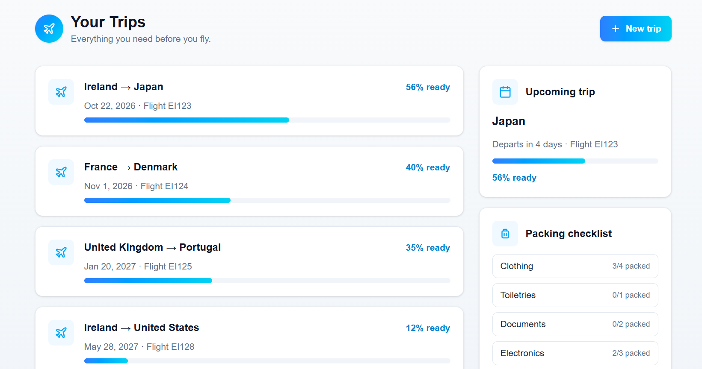

## PrepPoint AI (MVP)



PrepPoint AI is a flight preparation web app that helps travellers get ready from the moment they book to the moment they board. You enter your flight details and PrepPoint builds a timed pre-flight checklist, gives you AI travel tips and a packing list tailored to your destination, and shows how ready you are for every trip.


## Table of Contents

- [About](#about)
- [Project Goals](#project-goals)
- [User Stories](#user-stories)
  - [Navigation](#navigation)
  - [Trips](#trips)
  - [Preparation](#preparation)
- [Design](#design)
  - [Color Scheme](#color-scheme)
  - [Typography](#typography)
- [Features](#features)
- [Front-End Components](#front-end-components)
- [Technologies used](#technologies-used)
  - [Libraries, frameworks and dependencies](#libraries-frameworks-and-dependencies)
- [Testing](#testing)
- [Validation](#validation)
- [Bugs](#bugs)
- [Future Features](#future-features)
- [Deployment](#deployment)
- [Credits](#credits)
- [Media](#media)

## About

I built PrepPoint AI because getting ready for a flight involves lots of small tasks that are easy to forget: checking in online, packing, leaving for the airport on time. PrepPoint works backwards from your departure time to tell you when to do each one, and uses AI to suggest what to pack for where you're going.

## Project Goals

- Give travellers a clear, timed checklist for the hours and days before a flight.
- Use AI to give practical tips and a packing list for the destination and time of year.
- Let users keep track of several trips and see how prepared they are for each one.
- Keep the app working even if the AI service is unavailable.
- Validate every input on both the client and the server.

## User Stories

### Navigation

- As a user I can see what the app does on the landing page so that I can decide whether to use it.
- As a user I can get from any page back to my trips so that I never get stuck.
- As a user I can see a clear message if a trip doesn't exist so that I know what went wrong.

### Trips

- As a user I can enter my flight details so that the app can build my preparation plan.
- As a user I can pick my departure and destination country from a list so that I don't make typos.
- As a user I can see clear error messages when I enter something invalid so that I can fix it.
- As a user I can see all my saved trips on a dashboard so that I can find them quickly.
- As a user I can see my next upcoming trip and how many days are left so that I can plan ahead.
- As a user I can delete a trip after confirming so that I can remove trips I no longer need.
- As a user I can page through my trips so that the dashboard stays easy to scan.

### Preparation

- As a user I can see a timeline of tasks worked back from my departure time so that I know when to do each one.
- As a user I can tick off tasks so that I can track what I've done.
- As a user I can read AI travel tips for my destination so that I'm prepared for the weather and local conditions.
- As a user I can get a packing list suggested by AI so that I don't forget anything important.
- As a user I can tick off packed items by category so that I can see what's left to pack.
- As a user I can see a readiness score so that I know how prepared I am.
- As a user I can see a "You're ready" page when everything is done so that I know I'm set to go.

## Design

### Color Scheme

I wanted the app to feel calm and trustworthy, like a good airline app. I used soft slate backgrounds with white cards, and a blue-to-cyan gradient for buttons and highlights.

- Blue `#3B82F6` and Cyan `#22D3EE`: the gradient used for buttons, progress bars and the plane badge
- Sky `#0EA5E9`: icons, links and percentages
- Slate 50 `#F8FAFC`: page background
- Slate 900 `#0F172A`: headings
- Slate 500 `#64748B`: secondary text

### Typography

I used [Geist](https://vercel.com/font) through `next/font`, because it is clean and easy to read at small sizes on mobile.

##### Back to [top](#table-of-contents)

## Features

### Landing Page

- As a user I can see what the app does on the landing page so that I can decide whether to use it.

### Add Your Flight

- As a user I can enter my flight details so that the app can build my preparation plan.
- As a user I can see clear error messages when I enter something invalid so that I can fix it.

### Country Autocomplete

- As a user I can pick my departure and destination country from a list so that I don't make typos.

### Pre-Flight Timeline

- As a user I can see a timeline of tasks worked back from my departure time so that I know when to do each one.

### AI Travel Tips

- As a user I can read AI travel tips for my destination so that I'm prepared for the weather and local conditions.

### Packing Checklist

- As a user I can get a packing list suggested by AI so that I don't forget anything important.

### Dashboard

- As a user I can see all my saved trips on a dashboard so that I can find them quickly.

### Completion Page

- As a user I can see a "You're ready" page when everything is done so that I know I'm set to go.

##### Back to [top](#table-of-contents)

## Front-End Components

I built reusable components so every page looks consistent and a design change only happens in one place.

- **PageShell, PageHeader and BackLink:** the page background, width, centred header with the plane badge, and the back link.
- **Card:** the white rounded container used for every panel.
- **Button:** primary (gradient), secondary and danger variants in three sizes, with a disabled style.
- **ProgressBar:** the gradient progress bar, clamped between 0 and 100.
- **ChecklistItem:** a tickable row used on both the timeline and the packing list.
- **FormField:** a label, input and error message linked together for screen readers.
- **Autocomplete:** the country search field with a dropdown of matches.
- **Spinner:** the loading indicator.
- **TripNotFound:** one shared screen for unknown trip links.
- **IconTile and Icons:** the light blue icon squares and inline SVG icons.
- **useTrip (hook):** loads the trip for the current page from the URL and returns its loading status.

## Technologies used

- [Next.js](https://nextjs.org/) (App Router) for pages, routing and the API route
- [React](https://react.dev/) and [TypeScript](https://www.typescriptlang.org/)
- [Tailwind CSS](https://tailwindcss.com/) for styling
- [Google Gemini](https://ai.google.dev/) (`gemini-2.5-flash`) for travel tips and packing suggestions
- [Vitest](https://vitest.dev/) for automated tests
- [ESLint](https://eslint.org/) for linting
- [Vercel](https://vercel.com/) for hosting
- Git and GitHub for version control

### Libraries, frameworks and dependencies

- `next`, `react`, `react-dom`
- `@google/generative-ai`: the Gemini SDK, used only on the server so the API key never reaches the browser
- `tailwindcss` and `@tailwindcss/postcss`
- `vitest` (dev)
- `eslint` and `eslint-config-next` (dev)

##### Back to [top](#table-of-contents)

## Testing

I wrote unit tests with Vitest for the trip validation (`lib/validateTrip.test.ts`). The same validation function runs in the form and in the API route, so the tests cover both. There are 44 tests covering:

- Locations: random text, spaces only, HTML, very long input, different capitalisation, and domestic trips
- Flight numbers: valid formats, lowercase and trailing spaces, codes with no letter, and too many digits
- Dates and times: past dates, dates too far ahead, dates that don't exist, times that have already passed, return before departure, and trips longer than a year
- Travellers and budget: zero, decimals, negative numbers, text, scientific notation and commas

To run them:

```
npm test
```

## Validation

- **TypeScript:** `npx tsc --noEmit` reports no errors.
- **ESLint:** `npm run lint` passes with no errors or warnings.

## Bugs

| Bug | Fix |
| --- | --- |
| Saved checklist progress was wiped when returning to the timeline | The save effect ran before saved data had loaded. I added a "loaded" flag so saving only starts after loading. |
| New Tailwind classes (like the spinner animation) didn't show | The dev server was serving an old CSS build. Deleting the `.next` cache and restarting fixed it. |
| Users could open the packing page before the AI list had loaded | The Let's pack button is now disabled while tips are loading. |
| Clicking a trip on the dashboard seemed to do nothing | The details opened below all the cards, off screen. They now open directly under the clicked card. |
| The AI route sometimes returns a 500 | Gemini occasionally fails or is overloaded. The app shows a Try again button and falls back to a default packing list. |
| Random text could be entered in the form | Added a shared validation function used by the form and the API, with a country list and inline errors. |

##### Back to [top](#table-of-contents)

## Future Features

This is the MVP. Next, I plan to add:

- User accounts, so trips are saved and synced across devices.
- Smarter flight details, with less typing and live flight information.
- More personalised timelines that adapt to how each person likes to travel.
- Reminders that let users know when it's time for each task.
- Richer destination information with more accurate, up-to-date travel insights.
- Improved reliability and more automated testing.

##### Back to [top](#table-of-contents)

## Deployment

**Run it locally**

1. Clone the repository:

```
git clone https://github.com/damidaramola/prep-point-ai.git
cd prep-point-ai
```

2. Install the dependencies:

```
npm install
```

3. Create a `.env.local` file in the project root with your Gemini API key (get one from [Google AI Studio](https://aistudio.google.com/)):

```
GEMINI_API_KEY=your-key-here
```

4. Start the development server and open http://localhost:3000:

```
npm run dev
```

**Deploy to Vercel**

5. Push the project to GitHub.
6. Sign in to [Vercel](https://vercel.com/) with GitHub, click **Add New**, then **Project**, and import the repository.
7. Under **Environment Variables**, add `GEMINI_API_KEY` with your key.
8. Click **Deploy**. Every push to `main` deploys automatically after this.

##### Back to [top](#table-of-contents)

## Credits

- [Next.js documentation](https://nextjs.org/docs) for the App Router, API routes and dynamic routes.
- [React documentation](https://react.dev/) for effects and state management.
- [Tailwind CSS documentation](https://tailwindcss.com/docs) for the utility classes.
- [Google AI for Developers](https://ai.google.dev/) for the Gemini SDK.
- [Vitest documentation](https://vitest.dev/guide/) for setting up the tests.
- I used Claude Code as a pair programmer for reviewing my code, debugging and parts of the implementation.
## Media

- Icons are inline SVGs based on the [Lucide](https://lucide.dev/) icon set.
